# 掼蛋

两副牌的四人掼蛋网页游戏：进入大厅输入昵称，可以一个人和三位电脑玩家打，也可以开房间和朋友一起打。
包含洗牌切牌、进贡还贡、升级打 A、出牌计时、音效、语音和表情。第一次来先看下面的[使用说明](#使用说明ipad)。

在线玩：https://clintsun1977.github.io/guandan/

## 使用说明（iPad）

写给第一次来这个网站打牌的人，按 iPad 来讲（电脑上操作一样，用鼠标点）。截图来自 1110 版、iPad 横屏。

### 打开之前

- **用 Safari 打开** https://clintsun1977.github.io/guandan/ 。联机只能在这个正式网址上用。
- **横着拿 iPad。** 横屏、竖屏都能玩，转过来页面会自己重排；横屏的牌更大。
- **想要全屏：** Safari 点「分享」→「添加到主屏幕」，以后从桌面图标打开，没有地址栏和工具栏。
- **开头没声音是正常的。** 浏览器要先点一下屏幕才出声，随便点一下（比如输昵称）就好了。
- **开房间的人别锁屏、别切到别的 App 太久。** 可以在 iPad「设置 → 显示与亮度 → 自动锁定」里把时间调长。

### 大厅

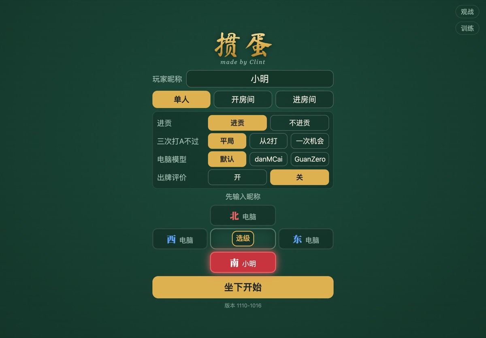

| 一行 | 做什么 |
| --- | --- |
| 玩家昵称 | 必须先填，最多 8 个字（手机上 3 个字），下次会记住 |
| 「单人」「开房间」「进房间」 | 一个人和三个电脑打 / 自己开房间等朋友 / 输入朋友给的房间号进去 |
| 进贡 | 默认「进贡」；选「不进贡」整场都不进贡 |
| 三次打A不过 | 打 A 三次都没过怎么办：「平局」（默认）、「从2打」、「一次机会」 |
| 电脑模型 | 电脑怎么出牌：「默认」是规则电脑，danMCai、GuanZero 是两个 AI 模型（开局多加载几秒） |
| 出牌评价 | 默认「关」；开了以后轮到你时左下角给你选的牌打「合理性」分（相对分，不是胜率） |
| 「选级」 | 方桌中间的按钮。不碰就从 2 开始；上一场没打完（至少打完过一局），点里面的「继续上一把」从上次的级数接着打（重新发牌） |

规则只有单人玩家或房主能改，进房间的朋友看到的按钮点不动，下面写着「规则由房主选定」。
右上角的「观战」是输入房间号旁观别人打牌（页面版本和房主不同也能看，画面可能有小出入）；「训练」要密码，普通玩家用不到。

### 一个人打（先练手）

1. 输入昵称。
2. 确认选中的是「单人」（金色）。
3. 点一个座位。南北是一队（红），东西是一队（蓝），坐对面的是队友。
4. 点「坐下开始」。

一个人打时，打开规则、退出确认这些面板，倒计时都会停住。

### 和朋友一起打

| 房主：点「开房间」，出现 4 位房间号 | 朋友：点「进房间」，输入房间号，点「进入」 |
| --- | --- |
| 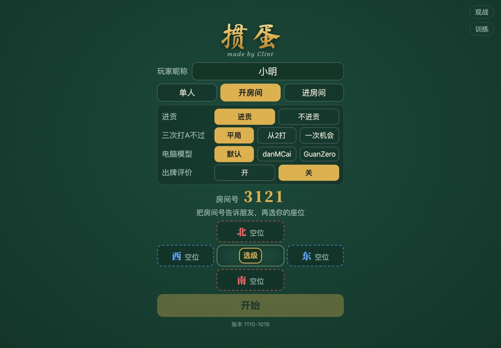 | 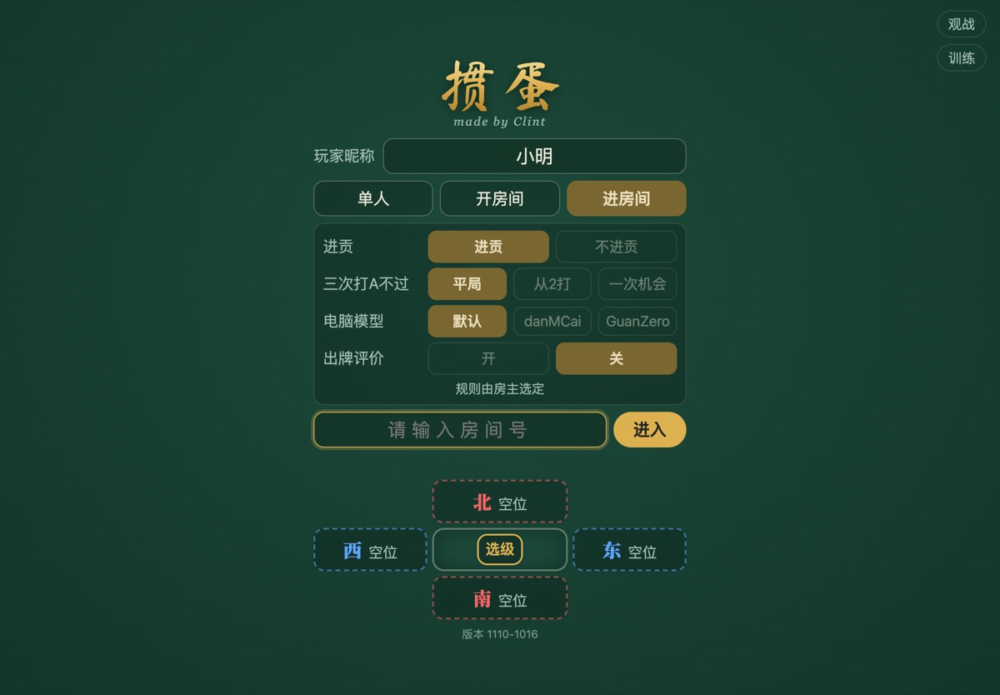 |

**房主（开房间的人）**

1. 输入昵称，点「开房间」，稍等出现金色的「房间号」。
2. 把房间号发给朋友。
3. 选好规则，点一个座位坐下。朋友坐下后，座位上会出现他们的名字。
4. 人到齐后点「开始」。不用坐满，没人坐的座位由电脑打。

**朋友（进房间的人）**

1. 输入昵称，点「进房间」。
2. 输入 4 位房间号（会弹出数字键盘），点「进入」。
3. 看到「选一个空座位」后点一个空位，想和谁一队就坐他对面。
4. 看到「已坐下，等待房主开始」就好了，房主点开始后自动进牌桌。

- **房主的页面要一直开着。** 整场牌在房主的 iPad 上跑，房主刷新或关掉页面，这一场就结束了；朋友会看到「和房主的连接断了」，可以选「和电脑继续打」。
- **每个人看到的都是自己坐在最下面**，队友在上方。
- 朋友中途掉线，座位先由电脑接着打。回来点「回到游戏」；或者回大厅（昵称别改）点「进房间」、输入同一个房间号，一般会自动坐回原位（提示「游戏已经开始，选你原来的座位」时点一下原来的座位）。手牌和出过的牌都在。
- 出现「页面版本和房主不同，请刷新页面……」：在 Safari 点刷新，再重新进房间。大厅最下面的「版本」要和房主一样。
- 联机是浏览器之间直接连接（PeerJS），个别网络环境可能连不上。iPad 或手机锁屏、切到别的应用，或者网页在后台放久了，和配对服务器的连接可能会断；网页会自动重新连上，房间号不变，新朋友照样能进来。
- 房主刚关掉或刷新页面后，服务器常常要一分钟左右才放出这个房间号；这段时间进房间，15 秒没有回应就会提示「房间没有回应」，稍后再试就行。

### 认识牌桌

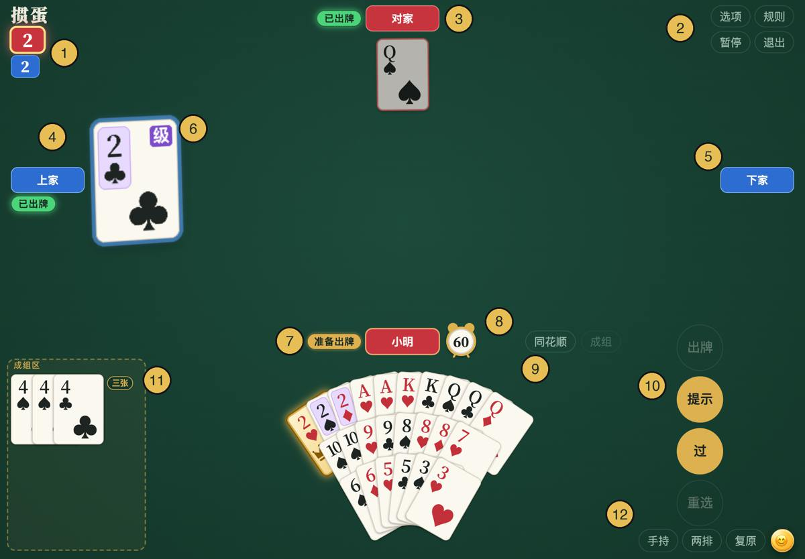

1. 两队的级数。上面的数字是**你们队**，下面是对方；带金框发光的是这局打的级。
2. 「选项」「规则」「暂停」「退出」。
3. 对家：你的队友，永远在上方。
4. 上家（左边，对手）。出牌顺序是你 → 下家 → 对家 → 上家。
5. 下家（右边，对手），在你后面出。
6. 桌上的牌：每个人出的牌摊在自己那一侧，边框是那一队的颜色；最新的一手最大，边框更粗、一闪一闪。
7. 状态：「准备出牌」= 轮到这个人；出过的写「已出牌」，不要的写「过」。
8. 你的名字栏和 60 秒倒计时小闹钟。
9. 「同花顺」「成组」：整理手牌用。
10. 出牌按钮一列：「出牌」「提示」「过」「重选」。金色能点，暗的点不了。
11. 成组区：把一组牌放在这里，留着一起出。
12. 手牌工具：第一个按钮是现在的排法（「手持」），第二个是点了会变成几排（「两排」），「复原」按大小重排；最右边是 😊 表情。

别人手里剩 10 张或更少时，名字旁会出现「N张」；出完牌的人标上头游、二游、三游、末游。

### 一局的流程

1. **洗牌、切牌**：轮到你时右边出现闪光的「洗牌」或「切牌」，点一下就行；15 秒不点会自动替你做。
2. **发牌**：自动发，每人 27 张，发完自动排好。
3. **进贡、还贡**：发完牌，上一局末游给头游一张最大的牌；收贡的人理牌时还一张 10 或以下的牌。第一局没有。
4. **理牌**：中间显示「理牌」和 90 秒倒计时，理好点「理牌结束」，大家都点了就开打。
5. **出牌**：轮流出，每手 60 秒。一方两人都出完，这局结束。
6. **结算**：屏幕下方出现结果，比如「对方升级：2 → 5」，点「下一局」。和朋友打时每个人都要点。

| 轮到你洗牌：点右边的「洗牌」 | 理牌：理好点「理牌结束」 |
| --- | --- |
| 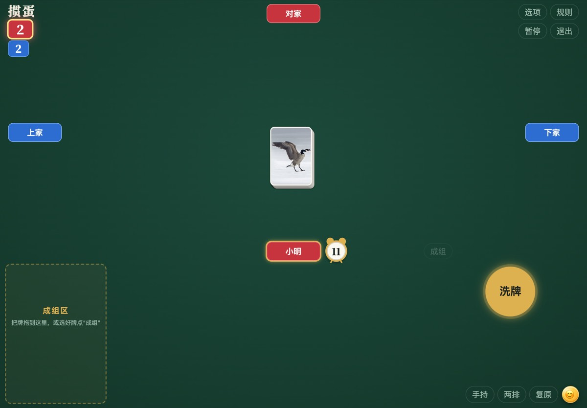 | 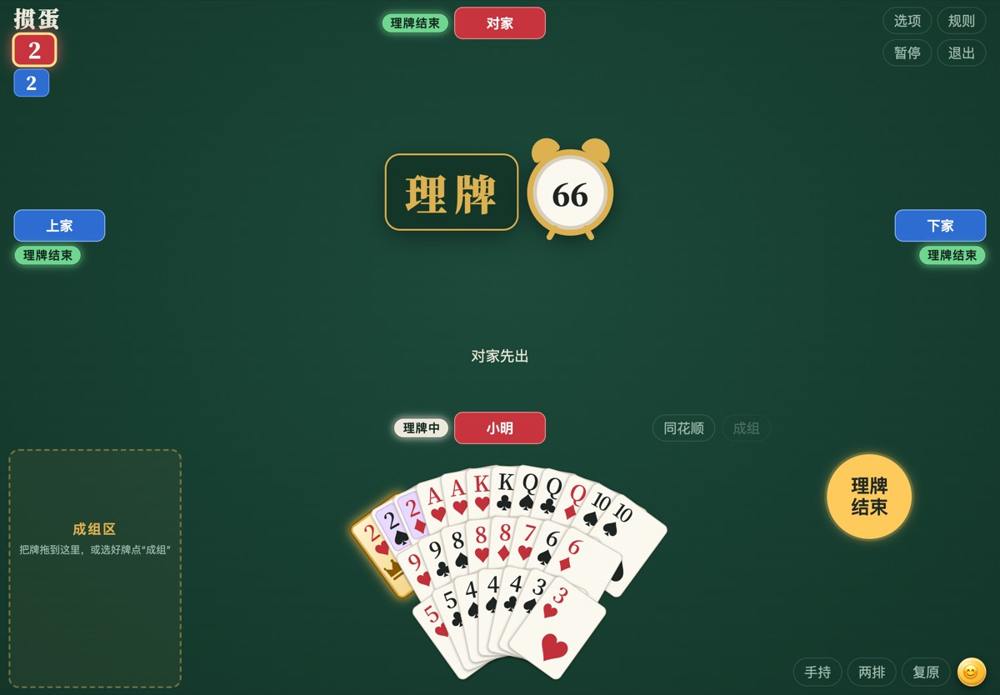 |

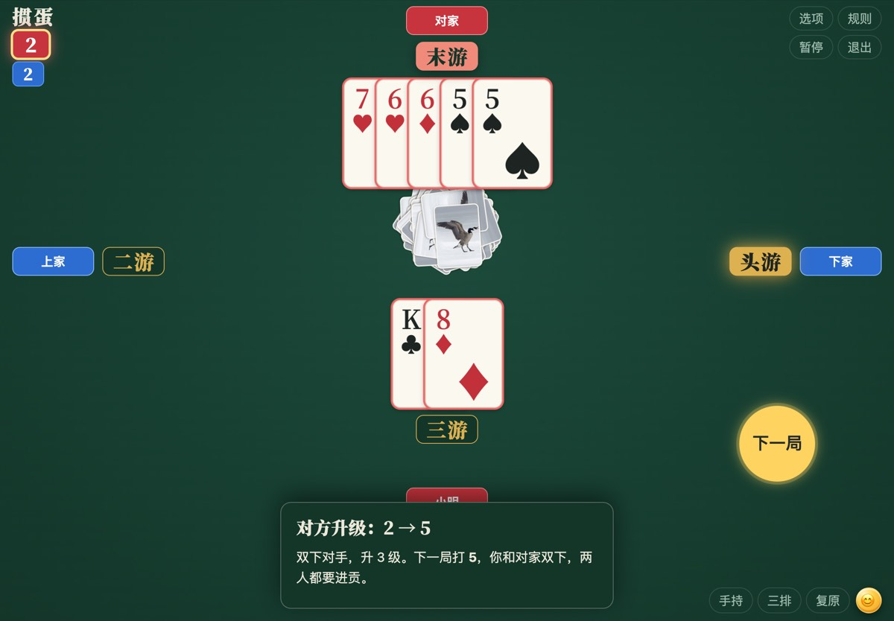

每局头游（第一个出完的人）那一方升级，升几级看队友排第几：队友二游升 3 级，三游升 2 级，末游升 1 级。
整场从 2 打到 A；打 A 的一方拿到头游、队友又不是末游，就赢下整场。细节随时可以点右上角「规则」看。

### 摆弄手牌

| 手势 | 效果 |
| --- | --- |
| 点一下 | 选牌，牌升起发亮；再点一下放回去 |
| 从没选的牌上滑过 | 手指滑过的牌全部选中，适合选顺子、连对 |
| 按住选中的牌拖 | 挪位置，拖到想放的地方松手 |
| 点空白处或「重选」 | 选中的牌全部放下 |
| 双击一张牌 | 把这张牌（或它所在的一组）连同已选的牌直接出出去（开了「出牌需确认」还要再点「确认」）；手快容易误出，不熟先别用 |
| 「复原」 | 散牌按大小重新排好（成组区里的不动） |

| 点选三张 4 | 点「成组」后进了成组区 |
| --- | --- |
| 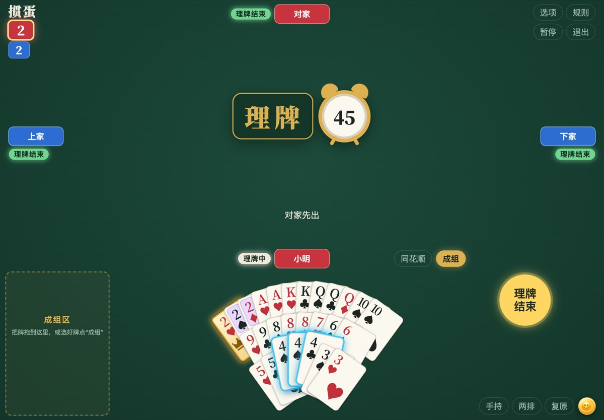 | 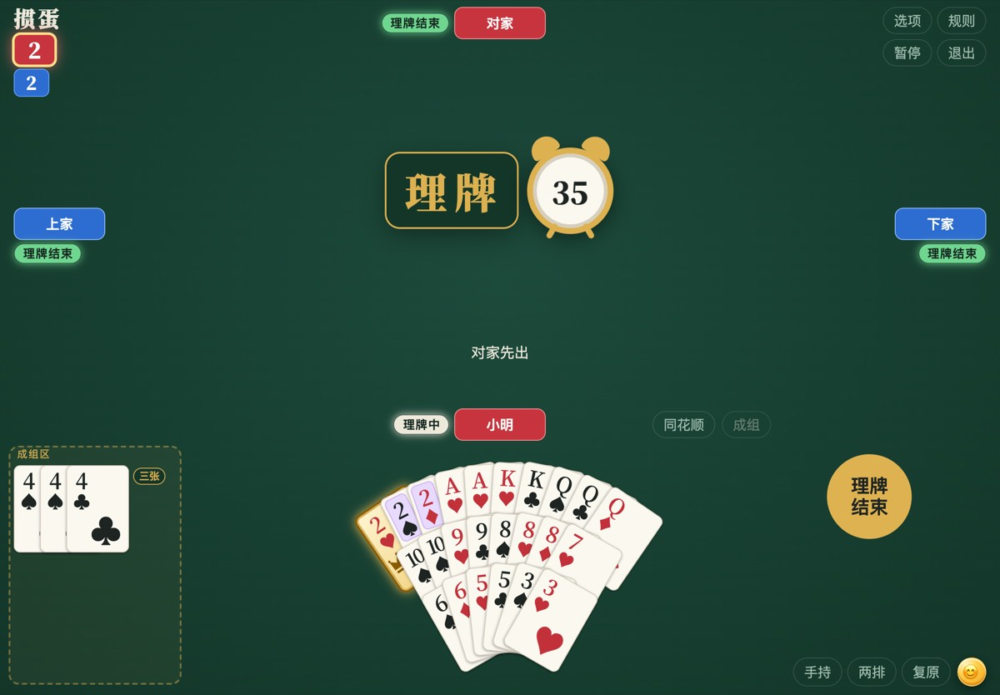 |

- **成组区**：选好牌点「成组」，或者把选中的牌拖进左边的虚线框，就成了一组，右上角写着牌型（顺子、炸弹、三带二……）。点组里的牌会选中整组，这时「成组」变成「放回」，点它放回手里。成组只是理牌，要出还得点「出牌」。
- **同花顺**：点「同花顺」，把手里能凑的同花顺一个个抬起来（百搭自动算进去），再点换下一个。
- **换排法**：第一个按钮写的是现在的排法，每点一下换一种：手持（扇形）→ 横式（平铺）→ 竖式（同点数叠一列）。第二个按钮写的是点了之后会变成几排（一排 / 两排 / 三排），竖式没有这个按钮。选好会记住。

### 出牌

轮到你时会响一声，名字栏亮起，旁边出现 60 秒倒计时。

| 点「提示」：自动抬起一手能管上的牌 | 点「出牌」：牌摊到桌上 |
| --- | --- |
| 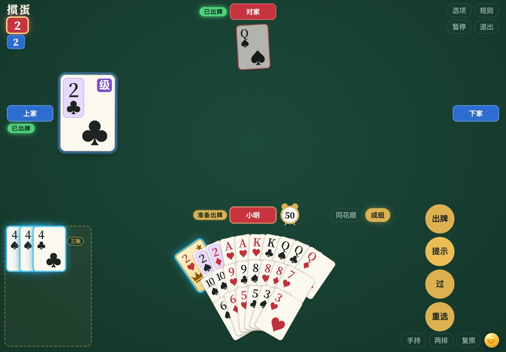 | 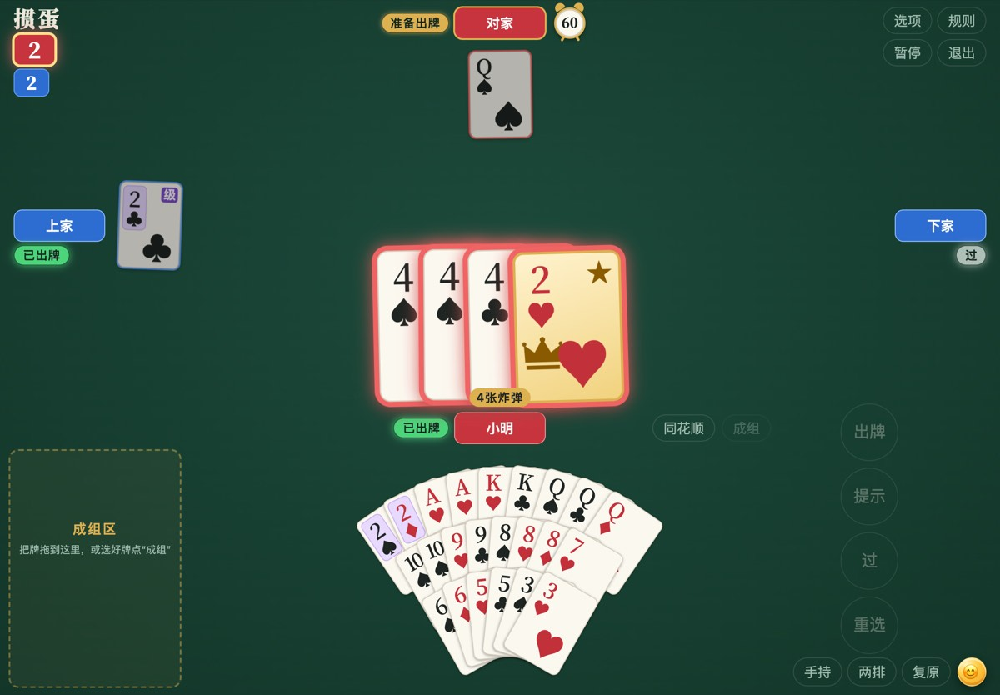 |

| 按钮 | 什么时候能点 | 做什么 |
| --- | --- | --- |
| 「出牌」 | 选的牌能出时才变金色 | 自己先出时随便出一种牌型；跟牌要同牌型、同张数、更大，也可以用炸弹（桌上已经是炸弹时要更大的炸弹） |
| 「提示」 | 轮到你时 | 帮你选一手能出的，再点换下一种；管不上时告诉你可以点「过」。只是帮忙，不一定是最好的打法 |
| 「过」 | 桌上有别人的牌时 | 这一手不要；自己先出时不能过 |
| 「重选」 | 选了牌时 | 选中的牌全部放下 |

- **认百搭**：这局打几，几就是级牌（带紫色「级」字）；**红桃级牌是百搭**（逢人配），金色牌面、有皇冠和 ★，可以当任何牌用。出牌时有百搭，网站自动按最有利、能管上的方式算。
- **时间到**：最后 10 秒小闹钟变红、晃动、每秒滴答。时间到了，跟牌时自动「过」；自己先出时自动替你出一手小牌。只替你走这一步，没有「托管」，下一手照常自己出。
- **怕误点**：「选项」里打开「出牌需确认」，点「出牌」后牌先放大显示在桌子中间，按钮变成闪烁的「确认」，再点一次才出。
- **接风**：一圈其他人都不要，最后出牌的人接着先出；如果他已经出完了，由他的队友接着出。

### 进贡和还贡

- 大厅选了「进贡」（默认）时，从第二局开始，上一局末游要进贡；一方是三游加末游（双下）时两人都进贡。
- **进贡**：通常自动交出手里最大的一张（百搭除外）。最大的牌有几张不同花色时才让你挑：点一张，再点金色的「进贡」。
- **还贡**：收到贡牌的人还一张 10 或以下、不是百搭的牌：点一张，再点「还贡」，理牌时就可以还。
- 进贡、还贡不能双击，要点按钮；不点的话时间到会自动替你交。
- 要进贡的人手里有两张大王（一人两张，或双下时两人各一张）就「抗贡」：这局不进贡也不还贡，上一局的头游先出。
- 谁给谁什么牌，理牌时写在桌子中间；开打后收进左上角级数下面的小按钮「贡」，点开能再看。
- 正常进贡时，交出最大那张贡牌的人先出。

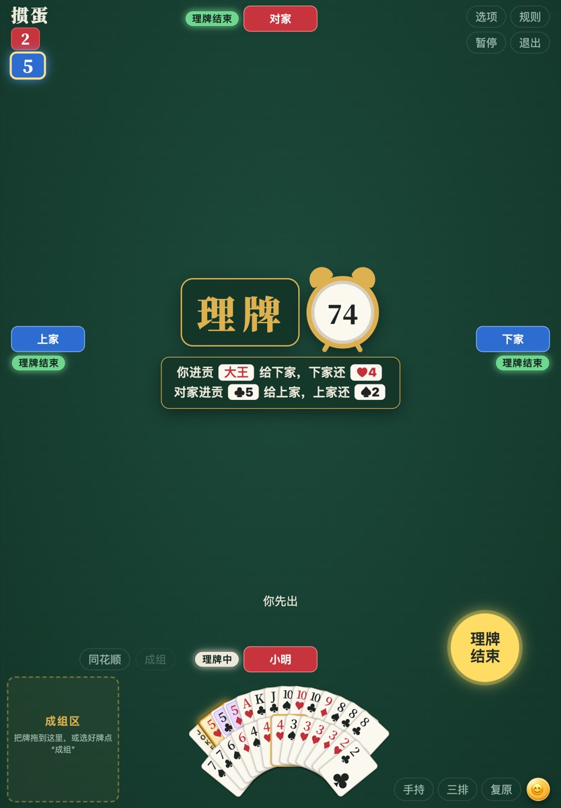

### 其他按钮

| 「选项」菜单 | 😊 表情面板 |
| --- | --- |
| 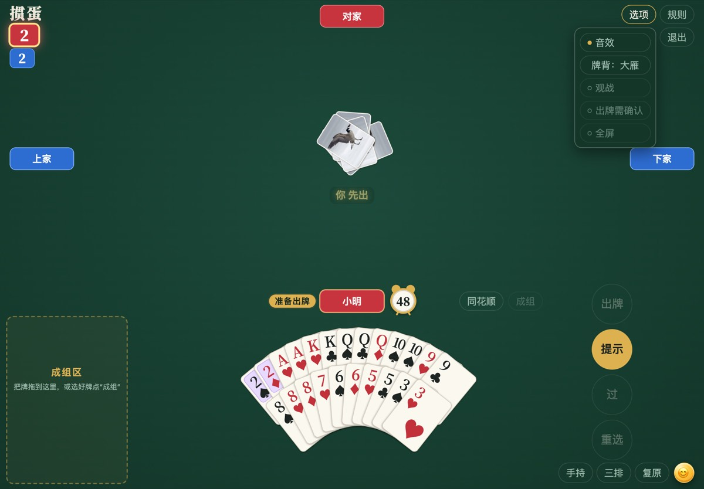 | 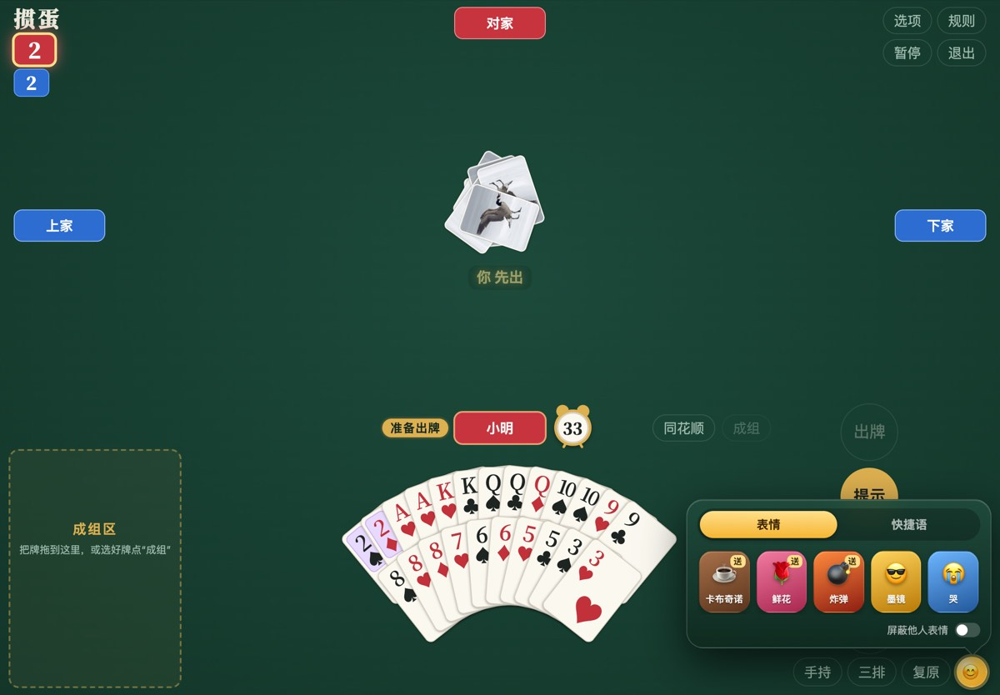 |

| 在哪 | 是什么 |
| --- | --- |
| 选项 → 音效 | 游戏音效和快捷语朗读的开关（没有背景音乐；语音聊天不受它影响），圆点实心 = 开 |
| 选项 → 牌背 | 每点一下换一种：大雁、枫叶、花纹、无 |
| 选项 → 观战 | 你自己出完牌后能看到另外三家剩的牌（和大厅的「观战」不是一回事） |
| 选项 → 出牌需确认 | 出牌前多一步「确认」，防误点 |
| 选项 → 全屏 | Safari 支持时才有；没有就用「添加到主屏幕」 |
| 选项 → 房间号 | 和朋友打时菜单第一行显示房间号 |
| 规则 | 带牌面例子的规则书：新手入门、牌型一览、升级进贡、操作计时；只能点右上角 × 关 |
| 暂停 | 大家的倒计时都停下；只有暂停的人或房主能继续 |
| 退出 | 先问「退出游戏？」。进房间的朋友退出后座位交给电脑；房主退出后其他人只能选「和电脑继续打」 |
| 闭麦 / 开麦 | 和朋友打、桌上有两个以上真人时才有。字是现在的状态：「闭麦」= 麦克风关着，点一下变「开麦」；第一次 Safari 会问能不能用麦克风，选允许 |
| 😊 | 送礼物（卡布奇诺、鲜花、炸弹）、戴墨镜、哭，或发 8 句快捷语，只能选不能打字；底下可以「屏蔽他人表情」 |

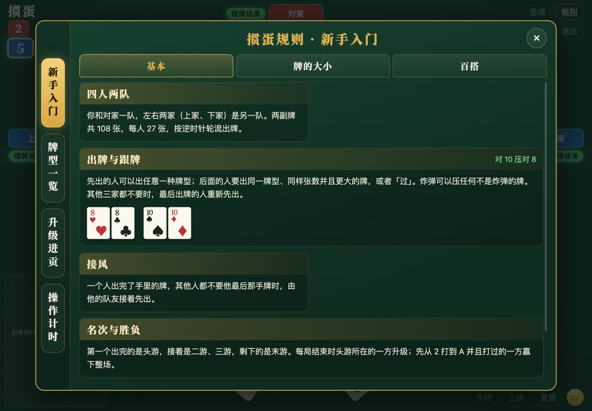

和朋友打时，看规则不会停表：轮到你时先出牌再看，或者先点「暂停」。

### 遇到问题

- **没有声音**：先在屏幕上随便点一下；再看「选项」里「音效」的圆点是不是实心；最后检查 iPad 音量和静音。
- **「出牌」一直是暗的**：选的牌现在不能出（不成牌型、管不上，或还没轮到你）。点「提示」看看，没有就点「过」。
- **手一滑出错了牌**：出去的牌收不回来。打开「选项」里的「出牌需确认」，也别用双击出牌。
- **输房间号说「没有这个房间」**：核对 4 位数字；确认房主的页面还开着、停在大厅。房主刷新过页面会拿到新号码。
- **一直「正在连接…」或提示「房间没有回应」**：房主可能刚关掉或刷新了页面，等一会儿再点「进入」。
- **朋友说「页面版本和房主不同」**：每个人都在 Safari 点刷新，再重新进房间。只有坐下打牌的人要和房主同一版本，观战不用。
- **掉线了 / 切出去再回来，牌桌没了**：点弹窗里的「回到游戏」。没有弹窗就回大厅（昵称别改）点「进房间」，输入同一个房间号。
- **房主那边断了**：大家会看到「和房主的连接断了」。网络闪一下的话点「回到游戏」；房主刷新或关了页面的话，想打完这一场就点「和电脑继续打」。
- **页面被两根手指放大了**：两根手指捏回去。点牌、双击都不会放大页面。
- **一个人打到一半想下次接着打**：打完的那几局的级数会记下来（退出时说的「不会保存」指的是正在打的那一局），下次在大厅点「选级」→「继续上一把」。

## 电脑

大厅「电脑模型」一行选择电脑怎么打，由单人玩家或房主选定，进房间的朋友只能看：

| 选项 | 说明 |
| --- | --- |
| **默认** | Clint 的规则机器人（本项目自己的），开局默认选中。四家都只剩 12 张以内时换上**残局大脑**：把没见过的牌随机发给另外三家（按他们出牌、过牌的表现加权，最多 40 种），每种用精确求解器算每个出法的结果，只有别的出法明显比规则的出法好（≥0.2 级）才改；一次出牌最多算 30 秒，来不及就用规则的出法；只用公开信息和自己的手牌，不偷看别人的牌 |
| **danMCai** | **引用自 [guandanai](https://github.com/stevensun1005/guandanai)**：danMCai 冠军 `017` 的网络，加上 guandanai 的搜索（编号 `9001`）。桌上四家合计剩 40 张以内时，先从公开出牌推断别家可能的暗牌、抽 8 种牌分布；21–40 张把 017 估值前 6 的出法和"过"在每种分布里都打到本局结束比较，20 张以内对每种出法精确求解。超过 40 张、只有一种出法或一手能出完时直接按 017 出。电脑和真人一样每手最多 60 秒：从轮到它起最多搜索 50 秒，没算完就出同时算好的 017，留 10 秒余量；这一手没算完不影响下一手照常搜索（多数决策不到 1 秒） |
| GuanZero | 神经网络 `guanzero-adp-io48-303975`，**引用自 guandanai** 最新发布的 GuanZero |

神经网络和搜索在房主的浏览器里运行（onnxruntime-web；danMCai 的搜索在单独的 Worker 线程里，不卡页面），只看自己的手牌和公开信息；进贡、还贡仍按 Clint 规则。
模型加载失败时，牌桌会提示一次，电脑改用 Clint 规则继续打。

## 出牌评价

大厅「出牌评价」默认是关；单人玩家或房主选「开」后，轮到你出牌，左下角会显示 danMCai 对你选的牌的**合理性**：这一手所有能出的牌（含"过"）里，
模型值最高的算 100%，最低的算 0%。出牌后保留**上一手**的评分，到这一局结束。只用你自己的手牌和公开信息；
这是相对分，不是胜率。手机上显示在顶栏右侧。点 × 本场不再显示。
桌上剩 40 张以内时，评价用和电脑同样的搜索（在你自己的浏览器里算，电脑出牌优先），算完才显示数字（之前显示「评价中…」）；
21–40 张时只有最有希望的几种出法有分，其他显示「不评分」；搜索没算完就显示 017 网络自己的分。
评价固定用 danMCai 打分，和大厅「电脑模型」选的是「默认」、danMCai 还是 GuanZero 无关。

## 表情（引用自 guandanai）

对局中点右下角「复原」右边的圆形 😊 按钮，弹出「表情」「快捷语」两页，**只能从预设里选，不能输入文字**；同一个人两次发送至少隔 2.5 秒。

- **送礼物**：卡布奇诺、鲜花、炸弹，选好再点送给哪一家，礼物从你的名字牌飞到对方名字牌（炸弹会爆炸、对方座位震动）。
- **表情**：墨镜、哭，显示在你自己的名字旁。
- **快捷语**：8 句寒暄（不含提示出牌的话），在名字旁弹出，并由浏览器的中文朗读念出（跟随「音效」开关）。
- **电脑会回礼**：送礼物给电脑座位，电脑约 1–2 秒后回送礼物、戴墨镜或哭；每个电脑 6 秒内只回一次，不影响出牌。
- 面板底部「屏蔽他人表情」只对你自己的浏览器生效。联机时只传预设编号，由房主核对后转发；表情不进出牌记录、牌谱或云端采集。训练版和观战不显示。

代码在 `web/src/social/emotes.js`，样式 `web/src/styles/emotes.css`，移植自 guandanai 的 `web/src/social/` 和 `styles/social.css`。

## 牌谱采集（上传到 guandanai）

房间里**发牌和开打时至少有两名真人**，每局打完后房主的页面会把这一局的牌谱上传到
[guandanai](https://github.com/stevensun1005/guandanai) 的真人牌谱云端（同一个 Cloudflare Worker + D1 数据库），和 guandanai 自己网站的牌谱放在一起，
供之后 AI 训练使用。单人局、只有一名真人的房间、训练版、观战，以及房主转为单机之后，都不上传。

- 内容：发牌、进还贡、每一手出牌和过牌（标明真人／电脑／超时托管、用的哪个电脑、是否看过出牌评价）、名次。格式与 guandanai 的
  [采集说明](https://github.com/stevensun1005/guandanai/blob/main/web/collector/README.md) 完全相同，服务端会重放整局核对。
- 包含房间号和每位真人的昵称（电脑座位没有昵称）；不含聊天、语音或 IP。四个座位另有只在本场有效的随机 ID。「选项」里显示上传状态。
- **每一小局打完立刻上传**，中途关掉网页也不影响已经打完的小局；只有关掉时正在打、没打完的那一小局传不了（云端只收能完整核对的小局）。
- **同一把（从 2 打到 A 的整场）的所有小局用同一个 `matchId`**，`round` 依次编号。导出后按 `matchId` 把小局合成一把；
  打完整把的那一小局，云端算出的 `result` 里 `win` 或 `draw` 为真。
- **中途关掉、回来接着打仍算同一把**：房主的浏览器记住这一把停在哪（双方级数、打谁的级、上局名次、打 A 次数）。
  回来后打开「选级」，点里面的「继续上一把」，自动选好级并接上同一个 `matchId`、接着编号；自己在选级里设成完全一样的状态也会接上。
  整把打完（打过 A 或平局）后就不再提示。需要同一台电脑、同一个浏览器开房。
- 断网或上传失败时先存在房主浏览器里（IndexedDB），之后自动重试，收到云端确认才删除。
- 本项目上传的牌谱 `appVersion` 以 `c1977` 开头，可与 guandanai 自己网站的牌谱区分；电脑 ID 用 guandanai 的发布编号
  （danMCai 记 guandanai 搜索机器人 `9001`，没搜索、按 017 出的牌也记 `9001`；GuanZero `023`），Clint 规则为 `clint-rule`、版本 `clintsun1977-…`。
- 网址加 `?test=1` 时上传为测试局（`kind=test`），guandanai 默认导出时不包含。

代码在 `web/src/collection/`（移植自 guandanai 的 `web/src/collection/`）。

## 引用 guandanai 的机器人

danMCai（含它的搜索）、GuanZero 两个神经网络机器人和出牌评价**不是本项目训练或原创的**，引用自
[stevensun1005/guandanai](https://github.com/stevensun1005/guandanai)（Steven Sun 的掼蛋 AI 项目）：

| 引用的内容 | 来自 guandanai | 在本项目 |
| --- | --- | --- |
| danMCai 权重 | Release [`web-model-017`](https://github.com/stevensun1005/guandanai/releases/tag/web-model-017)（训练任务 `mac-20261105`，版本 `v000855042`） | `bot/danmcai/danmcai-v000855042.onnx` |
| GuanZero 权重 | Release [`web-model-023`](https://github.com/stevensun1005/guandanai/releases/tag/web-model-023)（训练任务 `guanzero-adp-io48`，步数 303975） | `bot/guanzero/guanzero-adp-io48-303975.onnx` |
| 浏览器推理代码 | `web/src/ai/` 的 `encoding.mjs`、`history.mjs`、`candidates.js`、`observation.js`、`endgame.js`、`policy-inference.mjs`、`table-policy.mjs` | 移植为 `bot/neural/neural-bot.js` |
| danMCai 的搜索（`9001`） | 按 [`web/docs/REASON_BOT_INTEGRATION.md`](https://github.com/stevensun1005/guandanai/blob/main/web/docs/REASON_BOT_INTEGRATION.md) 第 4.1 节打包（提交 `bbc7ed6`），推断网络来自 Release [`web-belief-v1-16d76783`](https://github.com/stevensun1005/guandanai/releases/tag/web-belief-v1-16d76783) | `bot/reason/`（原样，SHA-256 见 [bot/reason/README](bot/reason/README.md)），接入代码 `web/src/game/reason-bot.js` |
| 出牌评价 | `web/src/coach/evaluation.mjs`、`controller.js` | `bot/neural/neural-bot.js`（017 打分）、`bot/reason/`（搜索值）、`web/src/coach/coach.js`（显示） |

权重文件和 guandanai 发布的完全相同（SHA-256 记录在 `bot/models.json`，构建时核对）；代码移植自 guandanai `main`
（提交 `fe066bc`，2026-11-07），只改成本项目单文件页面的写法，输入编码与候选出牌经逐局比对与原代码一致。
模型的训练、评测和冠军选择都在 guandanai 完成，详见其 [模型研究报告](https://github.com/stevensun1005/guandanai/blob/main/ai/research/MODEL_STUDY.md)
和 [网页模型说明](https://github.com/stevensun1005/guandanai/blob/main/web/docs/WEB_MODELS.md)。更新模型请从 guandanai 的新发布取，不要在这里改权重。

## 目录

```text
index.html          网站页面（由 web/build.py 生成，GitHub Pages 直接发布）
web/                网页端（每个功能一个文件，见 web/README.md）
  src/index.html    主页面：页面结构 + 按顺序引入各功能文件
  src/core/ game/ ui/ hand/ input/ lobby/ training/ network/ ...
  build.py          把 web/src 和 bot/ 合成根目录的 index.html
bot/                电脑玩家
  models.json       大厅里可选的电脑：名称、文件、SHA-256、来源
  clint/            Clint 规则机器人与残局大脑（精确求解器）
  neural/           神经网络电脑：特征编码、候选出牌、残局求解、ONNX 推理（移植自 guandanai）
  danmcai/          danMCai 权重（引用自 guandanai）
  reason/           danMCai 的搜索：guandanai 打包的 Worker、客户端、onnxruntime-web 和两个网络（原样引用）
  guanzero/         GuanZero 权重（引用自 guandanai）
```

修改 `web/` 或 `bot/` 后运行：

```bash
python web/build.py
```

本地试玩（模型需要通过 http 加载）：在仓库根目录运行 `python -m http.server 8000`，打开 http://localhost:8000/ 。
